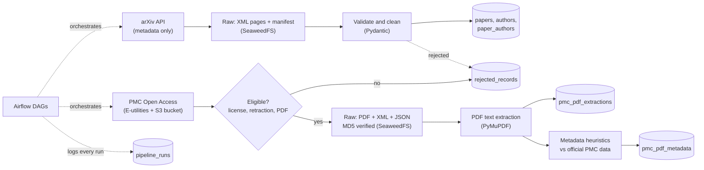

# Scientific Paper Data Pipeline

An end-to-end data engineering project that collects scientific paper metadata and open-access
full texts, validates and loads them into PostgreSQL, extracts text and metadata from PDFs, and
**measures how accurate that extraction is** against official ground-truth data. Everything is
orchestrated by Apache Airflow and every run is logged.

**Author:** <your name> · **Stack:** Python, Airflow, PostgreSQL, S3-compatible storage, Docker

## What it does

- Collects paper **metadata from arXiv** through its official API (no PDFs are downloaded from arXiv).
- Finds **open-access articles in PubMed Central (PMC)** with NCBI E-utilities and downloads their
  PDF, JATS XML and JSON metadata from the public PMC AWS bucket, **verifying MD5 checksums**.
- Keeps all raw data **unchanged** in an S3-compatible object store (SeaweedFS), so any step can be re-run.
- **Validates** every record with Pydantic. Bad records are not dropped silently: they are written to
  `rejected_records` with the reason.
- Extracts **text and metadata from PDFs** (PyMuPDF) and evaluates the heuristics against the official PMC data.
- Runs on a schedule with **Airflow**; every stage writes a row to `pipeline_runs` (rows in / out / rejected, status, error).

## Architecture



| DAG | Schedule (UTC) | Tasks |
|-----|----------------|-------|
| `arxiv_papers_pipeline` | daily 02:00 | `extract_raw` → `transform_load` |
| `pmc_papers_pipeline` | daily 03:00 | `download_pmc` → `extract_pdfs` → `evaluate_metadata` |

## Tech stack

| Area | Tools |
|------|-------|
| Orchestration | Apache Airflow 3.3 (LocalExecutor) |
| Storage | PostgreSQL 16, SeaweedFS (S3-compatible, via `boto3`) |
| Processing | Python, Pydantic, PyMuPDF, `requests` with retry and backoff |
| Packaging | Docker Compose |
| Quality | `pytest` (unit tests for validation, retry, tracking, PDF extraction), quality gates in the pipelines |

## Key design decisions

- **Immutable raw layer.** Raw responses are stored as received; parsing logic can change and be replayed.
- **Idempotent everywhere.** Deterministic object keys plus `INSERT ... ON CONFLICT DO UPDATE` mean re-running a stage never duplicates data.
- **Manifest as a commit marker.** A run is only processed if its `manifest.json` exists (written last), so half-finished extractions are ignored.
- **Fail loudly, record everything.** Transient errors (429/5xx/network) are retried with exponential backoff; permanent errors (e.g. 400) are not. Failures are logged to `pipeline_runs` and re-raised so Airflow marks the task failed.
- **Quality gates.** A run fails if too many records are rejected (arXiv load) or too many PDFs cannot be extracted (PMC).
- **Compliance first.** PMC articles are processed only if they are in the Open Access subset, not retracted, and licensed CC0, CC BY, CC BY-SA or CC BY-ND. arXiv PDFs are deliberately **not** downloaded, because arXiv does not permit automated full-text harvesting.
- **Honest evaluation.** The PDF heuristics were designed on a *dev* set (15 articles) and then frozen; accuracy is reported on a separate *test* set (72 articles) that was not used for design.

## Results: PDF metadata extraction

Ground truth is the official title and DOI from PMC's JSON/XML. *Title match* means text similarity ≥ 0.90.
Heuristic v1 finds the title as the largest-font text on the first page and the DOI with a regex on the first
page. v2 is identical except that the DOI is searched in the first **two** pages.

Test set: 72 PMC articles (all CC BY), several publishers and topics.

| Metric | Heuristic v1 | Heuristic v2 | PDF built-in metadata |
|--------|-------------:|-------------:|----------------------:|
| Title exact match | 70 / 72 (97.2%) | 70 / 72 (97.2%) | 45 / 72 (62.5%) |
| Title partial (subtitle missing or truncated) | 2 | 2 | – |
| DOI correct | 65 / 72 (90.3%) | **71 / 72 (98.6%)** | – |
| DOI not found | 7 | 0 | – |
| DOI wrong | 0 | 1 | – |
| Abstract recall (mean) | 0.984 | 0.984 | – |

Takeaways:

- Trusting the PDF's own metadata would give a wrong title in about 4 out of 10 articles; the font-size heuristic is wrong in none (2 are only partially right).
- v2 fixed all 7 missing DOIs that v1 had (the DOI sits on the second page for some publishers' templates), at the cost of **one wrong DOI**. A wrong value is worse than a missing one, so this trade-off is documented rather than hidden.
- *Abstract recall* is the share of unique words of the official abstract that also appear in the extracted text; 0.984 means the extracted text is nearly complete.
- With n = 72, an approximate 95% interval is roughly 90–99% for title and 93–99% for DOI. Report counts, not just percentages.

Known failure cases (not yet fixed): one article where a preprint DOI (OSF) was extracted instead of the article's own DOI, and two bioRxiv-template preprints where the extracted title was truncated or overly long. Their root causes have not been analysed yet.

Reproduce the report with `python -m src.pdf.report`.

## Data model

| Table | Purpose |
|-------|---------|
| `papers`, `authors`, `paper_authors` | Validated arXiv records, with full-text search index |
| `rejected_records` | Records that failed validation or eligibility, with reason and original payload |
| `pipeline_runs` | One row per pipeline stage run: status, rows in/out/rejected, error message |
| `pmc_articles` | PMC download ledger: license, MD5, storage keys, status, `eval_set` (dev/test) |
| `pmc_pdf_extractions` | Extracted full text, page and word counts, OCR-needed flag, PDF info |
| `pmc_pdf_metadata` | Heuristic title/DOI per extractor version, with comparison to ground truth |

A full data dictionary is planned in `docs/`.

## Repository layout

```
dags/            Airflow DAGs
sql/             Numbered, re-runnable migrations (001 ... 006)
src/
  extractors/    arXiv, Crossref and PMC clients
  ingestion/     raw-layer ingestion (arXiv pages, PMC files)
  transform/     Pydantic validation and cleaning
  load/          PostgreSQL upserts
  pdf/           PDF text extraction, metadata heuristics, accuracy report
  pipelines/     orchestrated stages and run tracking
tests/           pytest suite
Dockerfile.airflow, docker-compose.yml, requirements*.txt, .env.example
```

## Getting started

Requirements: Docker Desktop (at least 4 GB of memory for its Linux VM), Python 3.12.

```bash
python -m venv .venv
.venv\Scripts\Activate.ps1          # Windows PowerShell
pip install -r requirements.txt

copy .env.example .env              # then edit .env: passwords, e-mail addresses, JWT secret
```

`.env` needs: `POSTGRES_*`, `S3_*`, `NCBI_EMAIL` and `CROSSREF_MAILTO` (contact e-mails requested by NCBI and
Crossref), and `AIRFLOW_JWT_SECRET` (any long random string).

```bash
# 1) start storage and database first
docker compose up -d postgres seaweedfs

# 2) create the Airflow metadata database and the raw bucket
docker compose exec postgres psql -U pipeline -d papers -c "CREATE DATABASE airflow;"
docker compose exec seaweedfs sh -c "echo 's3.bucket.create -name papers-raw' | weed shell -master=localhost:9333"

# 3) apply migrations (from your machine; uses POSTGRES_HOST/PORT from .env)
python -m src.db

# 4) build and start Airflow
docker compose up -d
```

Open http://localhost:8080 (no login; bound to localhost only), unpause and trigger the two DAGs, or run
the stages manually:

```bash
python -m src.ingestion.arxiv_raw      # arXiv -> raw layer
python -m src.pipelines.arxiv_etl      # raw -> validated tables
python -m src.pipelines.pmc_pipeline   # PMC download -> PDF extraction -> evaluation
python -m src.pdf.report               # accuracy report
python -m pytest -v                    # tests
```

Notes: on a fresh database every PMC article is labelled `test`, because the `dev` label was assigned once to
the articles that already existed when migration 006 was first applied. PMC search results also change over
time, so the exact articles of the reported evaluation cannot be re-created. The Airflow UI runs without
authentication for local development; do not expose it.

## Data sources, licenses and attribution

- **arXiv:** metadata only, through the official API at a polite request rate. Thank you to arXiv for use of its open access interoperability.
- **PubMed Central (NIH/NLM):** article data from the PMC Open Access dataset on AWS. NLM is the source of these data. Only articles licensed for reuse are processed; no PMC logo or wordmark is used and no endorsement by NLM/NIH is implied. Article copyright remains with the respective publishers and authors.
- **Raw data is not committed to this repository.** Downloaded PDFs and text stay in the local object store.
- PyMuPDF is dual-licensed (AGPL or commercial); check its license before using this code in a closed-source product.

## Limitations and possible next steps

- Web crawling here means API and S3 collection; HTML scraping is not implemented.
- The Crossref client exists but is not part of the DAGs (enrichment by DOI is a natural next step).
- No language detection yet; full-text search uses the English configuration.
- Author names are deduplicated by exact string, so different people with the same name are merged.
- Failure notifications (e.g. n8n to Telegram/e-mail) are not set up; failures are visible in Airflow and `pipeline_runs`.
- Heuristic accuracy was measured on a limited set of publishers; results may differ for other layouts.

